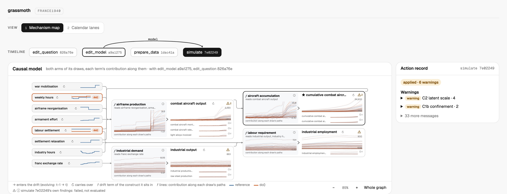

# grassmoth

[](https://github.com/ma9o/grassmoth/actions/workflows/ci.yml)
[](LICENSE)


**grassmoth** is an opinionated LLM harness for end-to-end Bayesian causal inference on longitudinal data.



> Would the Battle of France have gone differently had the French not limited the work week to 40 hours? [blog post](https://juliawillemyns.substack.com/p/nobody-decides-to-decline)

The harness exposes a DSL of seven actions over a [dependency graph of versioned artifacts](apps/grassmoth-server/src/grassmoth_server/study/state.py): the agent declares the desired next state, the framework resolves the dependencies and constraints to reach it, and the user follows progress and inspects results in the web UI.

- A [continuous-time nonlinear state-space model](#modeling) that handles irregular timestamps and missing observations, with its [assumptions](docs/assumptions.md) stated up front.
- blazing fast gpu inference automatically dispatched based on model type (see below); this is necessary for the agentic workflow as the model can make multiple fits quickly and support SBC
- inference targeting always the exact posterior -> important because?
- git based, declarative workflow with isolated effects; the llm does no state management

## Benchmarks

grassmoth's [marginalized particle Gibbs](docs/assumptions.md#inference-policy) sampler, from [Corenflos (2025)](https://arxiv.org/abs/2505.04611), updates latent paths with the [Particle-mGRAD](packages/grassmoth/src/grassmoth/models/ssm/inference/samplers/particle/marginal.py) sampler of [Corenflos & Finke (2024)](https://arxiv.org/abs/2401.14868) or with the [auxiliary Kalman sampler](packages/grassmoth/src/grassmoth/models/ssm/inference/samplers/particle/auxiliary_kalman.py) of [Corenflos & Särkkä (2025)](https://arxiv.org/abs/2303.00301), whole-path or in blocks. Both are exact for the nonlinear model, and NUTS is the reference.

### Stochastic volatility

This is the stochastic volatility model of [Kim, Shephard & Chib (1998)](https://doi.org/10.1111/1467-937X.00050), a test model in the [NUTS paper](https://jmlr.org/papers/v15/hoffman14a.html), with a cubic drift on the log-variance, fit to 3,000 simulated daily returns ([case](benchmarks/cases/suite/SV-cubic), [runs](benchmarks/suite/notes.md)). Each fit runs 80 chains on one H200.

| | mGRAD, 128 particles | Aux Kalman, whole path | Aux Kalman, 300-day blocks |
| --- | --- | --- | --- |
| Draws per chain | 4,000 | 4,000 | 10,000 |
| Compilation | 20.2 s | 5.9 s, partly cached | 16.4 s |
| Warmup and sampling | 6 min 52 s | **58 s** | 1 min 29 s |
| Worst bulk ESS | **4,800** | 368 | 2,020 |
| Worst R̂ | **1.016** | 1.160 | 1.037 |
| Worst bulk ESS per second | 11.7 | 6.3 | **22.8** |

NUTS takes about 20 minutes on an M1 Max CPU to reach ESS 9,395 and R̂ 1.003; on the H200 it completes only 101 of 2,000 warmup sweeps in 44 minutes. mGRAD and blocked Kalman reach R̂ below 1.05 in a third and a thirteenth of that time, and mGRAD's posterior means match NUTS's within two Monte Carlo standard errors. Whole-path Kalman is fastest, but a single accept/reject for all 3,000 days leaves its R̂ at 1.16.

### Lorenz-96

The stochastic [Lorenz-96 system](https://docs.dart.ucar.edu/en/latest/models/lorenz_96/readme.html) has 40 states, every other one observed at 300 time points ([case](benchmarks/cases/suite/L96), [runs](benchmarks/suite/notes.md)). Forcing and noise are known, so each fit smooths 12,000 latent coordinates per chain, with 2 chains on one H200.

| | mGRAD, 256 particles | Aux Kalman, whole path | Aux Kalman, 25-step blocks |
| --- | --- | --- | --- |
| Draws per chain | 4,000 | 4,000 | 10,000 |
| Compilation | 155.1 s | 31.7 s | **25.3 s** |
| Warmup and sampling | 26 min 38 s | **51 s** | 1 min 33 s |
| Worst bulk ESS | 2.4 | **63** | 31 |
| Worst R̂ | 2.51 | **1.059** | 1.076 |
| Worst bulk ESS per second | 0.0015 | **1.24** | 0.34 |

No fit reaches R̂ below 1.05, but whole-path Kalman delivers about 800 times mGRAD's ESS per second, because 256 particles can't cover 40 dimensions. NUTS would need about 9 hours on the M1 Max, by extrapolation from a partial run.

## Modeling

Causal identification on the SSM is achieved by temporally unrolling the DAG, as in [Jahn et al. (2025)](https://proceedings.mlr.press/v275/jahn25a.html), then running the [ID algorithm](https://doi.org/10.1016/j.artint.2008.12.006) on the unrolled segment for each treatment-outcome pair.

The system is a continuous-discrete nonlinear state-space model: the latent constructs evolve in continuous time as a stochastic differential equation, observed at discrete and possibly irregular times. The drift is a composite vector field — per-construct decay and intercepts plus linear, saturating (Hill), and bilinear edges — so the dynamics are nonlinear in general:

<!-- docs-latex:start eyJkaXNwbGF5Ijp0cnVlLCJsYXRleCI6ImRcXGJvbGRzeW1ib2x7XFxldGF9KHQpID0gXFxtYXRoYmZ7Zn1cXGJpZ2woXFxib2xkc3ltYm9se1xcZXRhfSh0KSwgdDsgXFxib2xkc3ltYm9se1xcdGhldGF9XFxiaWdyKVxcLGR0ICsgXFxtYXRoYmZ7R31cXCxkXFxtYXRoYmZ7V30odCkifQ -->
<p align="center">
  
</p>
<!-- docs-latex:end -->

Observations follow indicator-specific [observation laws](packages/grassmoth/src/grassmoth/artifacts/model/likelihood.py):

<!-- docs-latex:start eyJkaXNwbGF5Ijp0cnVlLCJsYXRleCI6InlfaSh0KSBcXG1pZCBcXGJvbGRzeW1ib2x7XFxldGF9KHQpIFxcc2ltIEZfaVxcIVxcbGVmdChnX2leey0xfVxcbGVmdCgoXFxib2xkc3ltYm9se1xcTGFtYmRhfVxcYm9sZHN5bWJvbHtcXGV0YX0odCkrXFxib2xkc3ltYm9se1xcbXV9KV9pXFxyaWdodCk7IFxcdGhldGFfaVxccmlnaHQpIn0 -->
<p align="center">
  
</p>
<!-- docs-latex:end -->

See [assumptions and limits](docs/assumptions.md) for the structural assumptions baked into the modeling framework and how far its results can be read.

## Quick Start

```bash
bun install --frozen-lockfile
uv sync --frozen --all-packages --group dev

# Environment — set OPENROUTER_API_KEY at minimum
cp .env.example.dev .env

# Start the web viewer and the tool server
# (bun run integration:start runs the full stack, including Temporal and the worker)
bun run dev
```

Then open the repository in Claude Code or Codex and give the agent your question and data. The [study API skill](.agents/skills/grassmoth-study-api/SKILL.md) teaches it the seven actions; follow the study in the web UI at `http://localhost:3000/v2/<workspace-id>`.

See the [dev setup guide](docs/guides/dev_setup.md) for full details including environment variables and optional dependencies.

## Documentation

- **How each action works:** [`edit_question`](docs/assets/action-flows/edit-question.svg), [edit_model](docs/assets/action-flows/edit-model.svg), [prepare_data](docs/assets/action-flows/prepare-data.svg), [fit](docs/assets/action-flows/fit.svg), [simulate](docs/assets/action-flows/simulate.svg), [data_diff](docs/assets/action-flows/data-diff.svg) and [model_diff](docs/assets/action-flows/model-diff.svg).
- **[Bayesian workflow](docs/assets/bayesian-workflow.svg):** the workflow of [Gelman, Vehtari & McElreath (2026)](https://users.aalto.fi/~ave/Bayesian-Workflow.pdf) mapped onto the seven actions.
- **[Assumptions and limits](docs/assumptions.md):** the modeling commitments behind every result.
- **Supported laws:** the library's [observation laws](packages/grassmoth/src/grassmoth/artifacts/model/likelihood.py) and [prior authoring definitions](packages/grassmoth/src/grassmoth/artifacts/probability/native.py).
- **API:** one POST per action returns running progress or the complete saved result; the remaining routes serve the slim timeline, workspaces and uploads. See the Swagger UI at `http://localhost:8100/api/docs` while the tool server runs, and the generated [study API reference](docs/reference/study-api.md).
- **Guides:** [dev setup](docs/guides/dev_setup.md), [integration testing](docs/guides/agentic_integration_testing.md), [code generation](docs/guides/codegen.md) and [benchmarks](docs/guides/running_evals.md).

## Credits

grassmoth builds on these open-source projects:

- [NumPyro](https://github.com/pyro-ppl/numpyro): distributions, effect handlers and the NUTS kernel.
- [dynestyx](https://github.com/BasisResearch/dynestyx): continuous-time dynamical models, Euler–Maruyama transitions and masked observation likelihoods.
- [Diffrax](https://github.com/patrick-kidger/diffrax): SDE and ODE solvers for predictive and counterfactual simulation.
- [BlackJAX](https://github.com/blackjax-devs/blackjax): step-size adaptation.
- [y0](https://github.com/y0-causal-inference/y0): the ID algorithm behind each identification check.
- [ArviZ](https://github.com/arviz-devs/arviz-stats): ESS, R̂, MCSE and LOO.
- [Pyro](https://github.com/pyro-ppl/pyro): the automatic reparameterization strategies, ported to NumPyro.

The papers behind its methods are cited where those methods appear, above and in [assumptions and limits](docs/assumptions.md).
