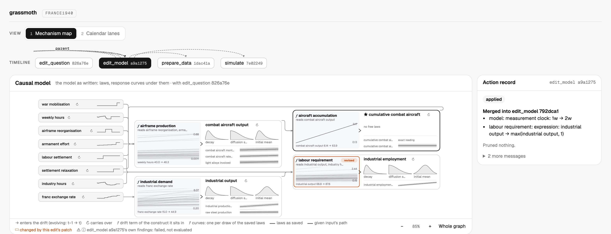
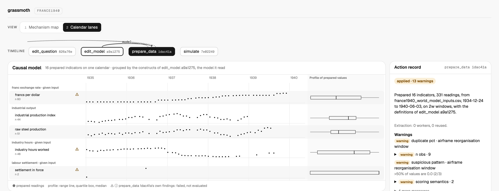

# grassmoth

[](https://github.com/ma9o/grassmoth/actions/workflows/ci.yml)
[](LICENSE)


**grassmoth** is an opinionated LLM harness for end-to-end Bayesian causal inference on longitudinal data.


*The FRANCE1940 study asks how many more combat aircraft French factories would have built from January 1937 to May 1940 had France worked British hours without the 1936 labour settlement. Its mechanism map shows a simulation of one contrast, with draws along the reference course in blue and under the interventions in orange.*

The framework transparently incorporates existing scientific knowledge, where available, as prior distributions and modeling assumptions. It uses defaults and a constrained modeling language to limit ad hoc choices made to fit the wording of a question. Its [assumptions and limits](docs/assumptions.md) make those scientific commitments explicit.

The user supplies a scientific question and observational data. The agent carries out the scientific work through seven public actions: [edit the question](docs/assets/action-flows/edit-question.svg), [edit the model](docs/assets/action-flows/edit-model.svg), [prepare data](docs/assets/action-flows/prepare-data.svg), [fit](docs/assets/action-flows/fit.svg), [simulate](docs/assets/action-flows/simulate.svg), [compare data](docs/assets/action-flows/data-diff.svg), and [compare models](docs/assets/action-flows/model-diff.svg). Every study starts by setting its question, whose outcome and queries the model is built to answer. Constructs, causal structure, measurements, fixed or estimable parameters, and probability laws can be revised together or incrementally. Fitting conditions the selected continuous-time nonlinear state-space model; simulation samples its current laws before or after fitting. [Numeric causal claims](docs/assumptions.md#numeric-causal-claims) require identification and matching evidence from a converged production fit.

## Features

- **Methodological rigor without friction** - Provide a dataset and a question, and grassmoth gives the most rigorous answer it can without pushing any methodological decision onto you.
- **Interpretability and interactivity** - Every model revision, check and result is recorded and can be inspected in the read-only web UI; users steer the agent in conversation through its CLI harness.
- **Support for large datasets, irregular timestamps and semantic heterogeneity** - via a continuous-discrete nonlinear state-space model — continuous-time latent dynamics observed at discrete, irregular timestamps — with non-Gaussian indicator-specific likelihoods (Poisson, Bernoulli, Beta, etc.).
- **Incremental numerical modeling and prior elicitation** - model revisions can be small and interleaved; the [model-edit chart](docs/assets/action-flows/edit-model.svg) shows the checks performed on each specification.
- **Fast and accurate parameter and state estimation in `jax`** - [Marginalized particle Gibbs with twisted Particle-aGRAD path updates](docs/assumptions.md#inference-policy) samples the exact nonlinear posterior on GPU in minutes. Efficient caching ensures that we never waste time waiting for compilation.
- **Compatible with `codex` and `claude-code`** - Use your existing agent subscription to drive the study through its public actions.

## Web UI

The web UI lays out a study's actions on a timeline and shows the state each one leaves, in two views of the same model.



*The mechanism map of the model as written: construct cards show their laws, and each mechanism ƒ shows its response, one curve per draw of the saved laws.*



*Calendar lanes put the 16 prepared indicators on one calendar, grouped by the constructs they measure, beside a profile of each indicator's values.*

## Benchmarks

grassmoth samples a nonlinear state-space model's parameters and latent paths jointly with [marginalized particle Gibbs](docs/assumptions.md#inference-policy). Two of its path updates compete here:

- [Particle-mGRAD](packages/grassmoth/src/grassmoth/models/ssm/inference/samplers/particle/marginal.py) proposes a cloud of particles at every time step.
- The auxiliary Kalman sampler of [Corenflos & Särkkä](https://arxiv.org/abs/2303.00301) proposes a whole Gaussian path, or one block of time at a time, and corrects it with a Metropolis–Hastings step against the exact model. It is a candidate that isn't on master yet.

NUTS, with NumPyro's default adaptation, is the reference.

Every fit runs through the same `fit` action on the same model and data, in float32, with seed 19 and 2,000 warmup sweeps. None replaces the nonlinear model it targets with an approximation.

- **Convergence check:** the [production convergence check](packages/grassmoth/src/grassmoth/models/ssm/inference/diagnostics/convergence.py) requires R̂ below 1.05, and bulk and tail ESS of at least 100 per chain, for every parameter and the worst latent time point.
- **Time:** counts warmup and sampling only. It leaves out setup and compilation, which depend on the compilation cache, as well as the convergence checks and saving.
- **Worst ESS:** the lowest over every parameter and latent time point.
- **Bold:** the best value in each row of the comparison tables.
- **Runs:** each column is one fit on one seed. The [run records](benchmarks/suite/notes.md) hold the fits behind every number.

### Stochastic volatility

This is a nonlinear version of the Gaussian stochastic volatility model of [Kim, Shephard & Chib (1998)](https://doi.org/10.1111/1467-937X.00050), one of the four test models in the [NUTS paper](https://jmlr.org/papers/v15/hoffman14a.html).

- **Model:** the log-variance follows a continuous-time diffusion with drift −θh − 0.03h³. Its cubic term pulls large excursions back faster than the original's Ornstein–Uhlenbeck drift.
- **Data:** 3,000 simulated daily returns ([model and data](benchmarks/cases/suite/SV-cubic)).
- **Worst quantity:** vol-of-vol σ, in every fit.

| | mGRAD | Aux Kalman | Aux Kalman, blocked | NUTS | NUTS |
| --- | --- | --- | --- | --- | --- |
| Path update or parameterization | 128 particles | Whole path | 300-day blocks | Non-centred | Centred |
| Hardware | H200 | H200 | H200 | M1 Max CPU, 8 performance cores | H200 |
| Chains × retained draws | 80 × 4,000 | 80 × 4,000 | 80 × 10,000 | 32 × 1,000 | 80 × 4,000 |
| Warmup | 136 s | **16.8 s** | 17.4 s | 976 s | 932 s |
| Sampling | 276 s | **41 s** | 97 s | 179 s | 884 s |
| One sweep of all chains | 68.9 ms | 10.3 ms | **9.7 ms** | 179.4 ms | 221.0 ms |
| Draws per effective sample | 67 | 868 | 536 | **3.4** | 171 |
| Worst bulk ESS | 4,800 | 368 | 1,492 | **9,395** | 1,869 |
| Worst R̂ | 1.016 | 1.160 | 1.038 | **1.003** | 1.041 |
| Convergence check | ESS below 8,000 | R̂ and ESS fail | ESS below 8,000 | **Passes, against 3,200** | ESS below 8,000 |
| Worst bulk ESS per second of sampling | 17.4 | 8.9 | 15.4 | **52.4** | 2.1 |
| Worst bulk ESS per second of warmup and sampling | 11.7 | 6.3 | **13.0** | 8.1 | 1.0 |
| Cost of that time at Modal rates | $0.59 | $0.08 | $0.16 | **No cloud charge** | $2.60 |

- **Kalman sweeps fastest, but each sweep moves less.**
  - A whole-path Kalman sweep costs a seventh of mGRAD's. But one accept/reject for all 3,000 days forces small moves, so it needs 13 times the draws per effective sample and delivers half mGRAD's ESS per second.
  - Blocks of 300 days, each accepted separately, close most of that gap. On warmup and sampling together they edge ahead, partly because 10,000 draws spread a warmup that was already 8 times shorter.
- **NUTS mixes best per draw.** On eight CPU cores it needs 3.4 draws per effective sample and leads on sampling 3 to 1, but warmup takes 84% of its time.
- **NUTS can't use the GPU on this model.** Non-centred NUTS rebuilds the path from its innovations in a [sequential scan](packages/grassmoth/src/grassmoth/models/ssm/execution/innovations.py) at every leapfrog step. On the H200 it reached 101 of 2,000 warmup sweeps in 44 minutes, about 23 s per sweep. Centred NUTS avoids the scan but mixes poorly: 171 draws per effective sample and 1,897 divergences in warmup.
- **The ESS bar scales with chains.** The check asks the 80-chain fits for 8,000 ESS and the 32-chain NUTS fit for 3,200.

| Parameter | Truth | mGRAD | NUTS, non-centred |
| ---: | ---: | ---: | ---: |
| Level μ | −0.2 | −0.180 [−0.322, −0.037] | −0.180 [−0.321, −0.037] |
| Decay θ | 0.02 | 0.0150 [0.0000, 0.0301] | 0.0152 [0.0000, 0.0305] |
| Vol-of-vol σ | 0.2 | 0.194 [0.150, 0.237] | 0.195 [0.151, 0.238] |

The table shows posterior means with 94% HDIs. The two samplers' means differ by at most 2.0 combined Monte Carlo standard errors, for vol-of-vol.

### Lorenz-96

- **Model:** the stochastic [Lorenz-96 system](https://docs.dart.ucar.edu/en/latest/models/lorenz_96/readme.html), with 40 coupled states and forcing 8, at 300 time points 0.01 apart.
- **Data:** every other state is observed with Gaussian noise, giving 6,000 readings ([model and data](benchmarks/cases/suite/L96)).
- **No parameters to learn:** the forcing and both noise scales are known, so each fit smooths 12,000 latent coordinates per chain.

| | mGRAD | Aux Kalman | Aux Kalman, blocked | NUTS |
| --- | --- | --- | --- | --- |
| Path update or parameterization | 256 particles | Whole path | 25-step blocks | Non-centred |
| Hardware | H200 | H200 | H200 | M1 Max CPU, 8 performance cores |
| Chains × retained draws | 2 × 4,000 | 2 × 4,000 | 2 × 10,000 | 32 × none: stopped in warmup |
| Warmup | 534 s | 17.0 s | **15.8 s** | 26 of 51 probe sweeps in 49 min |
| Sampling | 1,064 s | **34 s** | 77 s | — |
| One sweep of all chains | 266 ms | 8.5 ms | **7.7 ms** | — |
| Worst bulk ESS | 2.4 | **63** | 31 | — |
| Worst R̂ | 2.51 | **1.059** | 1.076 | — |
| Worst bulk ESS per second of sampling | 0.002 | **1.86** | 0.41 | — |
| Worst bulk ESS per second of warmup and sampling | 0.0015 | **1.24** | 0.34 | — |

No fit passes the check, which asks two chains for 200 ESS. These fits measure relative speed, not a posterior.

- **The whole-path Kalman sampler wins by about 800 times.**
  - On identical source and settings, its sweep takes 13.5 ms against mGRAD's 280 ms.
  - mGRAD scores 39 million particle pairs per sweep in its backward pass.
  - 256 particles can't cover 40 dimensions: every state's worst bulk ESS stays between 2.4 and 3.0.
- **Blocking hurts here.**
  - 25-step blocks moved each stretch of the path more per sweep, but cut ESS per second 4.6 times.
  - Blocks held in place by their neighbours can't shift the slow, path-wide components.
  - The series is short and its 0.01 steps nearly linear, which suits whole-path proposals.
- **NUTS didn't finish warmup.** A 32-chain probe managed 26 of its 51 warmup sweeps in 49 minutes on the M1 Max before it was stopped.
- **This model needs changes that aren't on master yet:**
  - keeping unobserved coupled states;
  - charts for a model with no free parameters;
  - mGRAD's backward-pair scoring bounded to one time point, which removes a 467 GiB allocation.

  80-chain mGRAD fits failed on the H200 with CUDA errors. So these fits use two chains, CUDA 12 and a Jacobi eigenvalue solver.

## Modeling

Causal identification on the SSM is achieved by temporally unrolling the DAG, as in [Jahn et al. (2025)](https://proceedings.mlr.press/v275/jahn25a.html), then running the [ID algorithm](https://doi.org/10.1016/j.artint.2008.12.006) on the unrolled segment for each treatment-outcome pair.

The system is a continuous-discrete nonlinear state-space model: the latent constructs evolve in continuous time as a stochastic differential equation, observed at discrete and possibly irregular times. The drift is a composite vector field — per-construct decay and intercepts plus linear, saturating (Hill), and bilinear edges — so the dynamics are nonlinear in general:

<!-- docs-latex:start eyJkaXNwbGF5Ijp0cnVlLCJsYXRleCI6ImRcXGJvbGRzeW1ib2x7XFxldGF9KHQpID0gXFxtYXRoYmZ7Zn1cXGJpZ2woXFxib2xkc3ltYm9se1xcZXRhfSh0KSwgdDsgXFxib2xkc3ltYm9se1xcdGhldGF9XFxiaWdyKVxcLGR0ICsgXFxtYXRoYmZ7R31cXCxkXFxtYXRoYmZ7V30odCkifQ -->
<p align="center">
  
</p>
<!-- docs-latex:end -->

Observations follow indicator-specific [observation laws](packages/grassmoth/src/grassmoth/artifacts/model/likelihood.py):

<!-- docs-latex:start eyJkaXNwbGF5Ijp0cnVlLCJsYXRleCI6InlfaSh0KSBcXG1pZCBcXGJvbGRzeW1ib2x7XFxldGF9KHQpIFxcc2ltIEZfaVxcIVxcbGVmdChnX2leey0xfVxcbGVmdCgoXFxib2xkc3ltYm9se1xcTGFtYmRhfVxcYm9sZHN5bWJvbHtcXGV0YX0odCkrXFxib2xkc3ltYm9se1xcbXV9KV9pXFxyaWdodCk7IFxcdGhldGFfaVxccmlnaHQpIn0 -->
<p align="center">
  
</p>
<!-- docs-latex:end -->

See [assumptions and limits](docs/assumptions.md) for the structural assumptions baked into the modeling framework and how far its results can be read.

## Quick Start

```bash
bun install --frozen-lockfile
uv sync --frozen --all-packages --group dev

# Environment — set OPENROUTER_API_KEY at minimum
cp .env.example.dev .env

# Start the web viewer and the tool server
# (bun run integration:start runs the full stack, including Temporal and the worker)
bun run dev
```

Then open the repository in Claude Code or Codex and give the agent your question and data. The [study API skill](.agents/skills/grassmoth-study-api/SKILL.md) teaches it the seven actions; follow the study in the web UI at `http://localhost:3000/v2/<workspace-id>`.

See the [dev setup guide](docs/guides/dev_setup.md) for full details including environment variables and optional dependencies.

## Documentation

- **How each action works:** [`edit_question`](docs/assets/action-flows/edit-question.svg), [edit_model](docs/assets/action-flows/edit-model.svg), [prepare_data](docs/assets/action-flows/prepare-data.svg), [fit](docs/assets/action-flows/fit.svg), [simulate](docs/assets/action-flows/simulate.svg), [data_diff](docs/assets/action-flows/data-diff.svg) and [model_diff](docs/assets/action-flows/model-diff.svg).
- **[Bayesian workflow](docs/assets/bayesian-workflow.svg):** the book's workflow mapped onto the seven actions.
- **[Assumptions and limits](docs/assumptions.md):** the modeling commitments behind every result.
- **Supported laws:** the library's [observation laws](packages/grassmoth/src/grassmoth/artifacts/model/likelihood.py) and [prior authoring definitions](packages/grassmoth/src/grassmoth/artifacts/probability/native.py).
- **API:** one POST per action returns running progress or the complete saved result; the remaining routes serve the slim timeline, workspaces and uploads. See the Swagger UI at `http://localhost:8100/api/docs` while the tool server runs, and the generated [study API reference](docs/reference/study-api.md).
- **Guides:** [dev setup](docs/guides/dev_setup.md), [integration testing](docs/guides/agentic_integration_testing.md), [code generation](docs/guides/codegen.md) and [benchmarks](docs/guides/running_evals.md).
