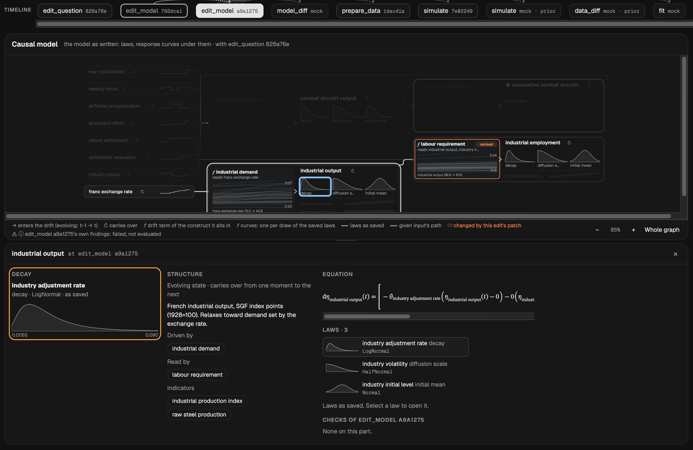

# grassmoth

[](https://github.com/ma9o/grassmoth/actions/workflows/ci.yml)
[](LICENSE)


**grassmoth** is an opinionated LLM harness for end-to-end Bayesian causal inference on longitudinal data.



> Would the Battle of France have gone differently had the French not limited the work week to 40 hours? ([Willemyns & McClements, 2026](https://juliawillemyns.substack.com/p/nobody-decides-to-decline))

The harness exposes a DSL of seven actions over a [dependency graph of versioned artifacts](apps/grassmoth-server/src/grassmoth_server/study/state.py): the agent declares the desired next state, the framework resolves the dependencies and constraints to reach it, and the user follows progress and inspects results in the web UI. Because state is declarative and abstracted at the DSL level, the LLM does no state management and the UI can show every modeling choice with its motivation.

Such restrictions applied to the [Bayesian Workflow](https://users.aalto.fi/~ave/Bayesian-Workflow.pdf) aim to address the tendency of LLMs to adopt different ad-hoc machinery and vocabulary across studies - often chosen with the answer or existing literature in mind - rendering modeling choices hard to compare.

Every study is a [continuous-time nonlinear state-space model](docs/assumptions.md#model-class), with support for irregular observations - either pointwise or window aggregates - and popular transition functions, likelihood and distribution families. We enforce [first-order Markov](docs/assumptions.md#a3-markov-dynamics) dynamics with no explicit delays or higher-order lags. This can seem overly restrictive in complex scenarios and overly pedantic in simpler ones, but nonetheless enforces a common structure that fundamentally enables comparisons between different levels of model complexity for the same problem.  It is also the structure the samplers exploit.

The only available samplers always target the exact posterior. Gelman's [folk theorem](https://statmodeling.stat.columbia.edu/2008/05/13/the_folk_theore/) holds that computational trouble often signals a problem with the model, and the agent can't switch to an approximation that hides it (unless translated into model specification). This results in a workflow where the LLM frequently cycles between specification and fitting. To keep fitting interactive we implemented [Corenflos & Finke (2024)](https://arxiv.org/abs/2401.14868) and [Corenflos & Särkkä (2025)](https://arxiv.org/abs/2303.00301), which leverage model properties and GPU parallelism to obtain inference times on the order of minutes for the representative classes of problems below.

### [Stochastic volatility](https://doi.org/10.1111/1467-937X.00050) with cubic drift

Long path (3,000 steps of one state), nonlinear in both the observation (the state sets each return's variance) and the dynamics (a cubic drift pulls the log-variance back), with unknown parameters (persistence and noise scale). See the [case](benchmarks/cases/suite/SV-cubic).

| | mGRAD 256 particles | Blocked aux-Kalman |
| --- | --- | --- |
| Hardware | H200 | L40S |
| Draws x chains | 4,000 x 80 | 10,000 x 80 |
| Warmup and sampling | 4 min 52 s | **1 min 29 s** |
| Worst bulk ESS | **4,800** | 2,020 |
| Worst R̂ | **1.016** | 1.037 |
| Worst bulk ESS per second | 11.7 | **22.8** |

### [Lorenz-96](https://docs.dart.ucar.edu/en/latest/models/lorenz_96/readme.html)

Wide path (40 states per step), nonlinear in the dynamics (chaotic coupling), with unknown states (half never observed). See the [case](benchmarks/cases/suite/L96).

| | mGRAD 256 particles | Blocked aux-Kalman |
| --- | --- | --- |
| Hardware | H200 | L40S |
| Draws x chains | 4,000 x 80 | 10,000 x 80 |
| Warmup and sampling | 18 min 38 s | **1 min 33 s** |
| Worst bulk ESS | 2.4 | **31** |
| Worst R̂ | 2.51 | **1.04** |
| Worst bulk ESS per second | 0.0015 | **0.34** |

## Quick Start

```bash
bun install --frozen-lockfile
uv sync --frozen --all-packages --group dev

# Environment — set OPENROUTER_API_KEY at minimum
cp .env.example.dev .env

# Start the web viewer and the tool server
# (bun run integration:start runs the full stack, including Temporal and the worker)
bun run dev
```

Then open the repository in Claude Code or Codex and give the agent your question and data. The [study API skill](.agents/skills/grassmoth-study-api/SKILL.md) teaches it the seven actions; follow the study in the web UI at `http://localhost:3000/workspaces/<workspace-id>`.

See the [dev setup guide](docs/guides/dev_setup.md) for full details including environment variables and optional dependencies.

## Documentation

- **How each action works:** [`edit_question`](docs/assets/action-flows/edit-question.svg), [`edit_model`](docs/assets/action-flows/edit-model.svg), [`prepare_data`](docs/assets/action-flows/prepare-data.svg), [`fit`](docs/assets/action-flows/fit.svg), [`simulate`](docs/assets/action-flows/simulate.svg), [`data_diff`](docs/assets/action-flows/data-diff.svg) and [`model_diff`](docs/assets/action-flows/model-diff.svg).
- **[Bayesian workflow](docs/assets/bayesian-workflow.svg):** the workflow of [Gelman, Vehtari & McElreath (2026)](https://users.aalto.fi/~ave/Bayesian-Workflow.pdf) mapped onto the seven actions.
- **[Assumptions and limits](docs/assumptions.md):** the modeling commitments behind every result.
- **Supported laws:** the [observation law](docs/reference/statistical-model-spec/likelihoods.md) and [parameter and prior](docs/reference/statistical-model-spec/parameters.md) references.
- **API:** one POST per action returns running progress or the complete saved result; the remaining routes serve the slim timeline, workspaces and uploads. See the Swagger UI at `http://localhost:8100/api/docs` while the tool server runs, and the generated [study API reference](docs/reference/study-api.md).
- **Guides:** [dev setup](docs/guides/dev_setup.md), [integration testing](docs/guides/agentic_integration_testing.md), [code generation](packages/api-types/AGENTS.md#code-generation), [public study library](docs/guides/public_study_library.md) and [benchmarks](docs/guides/running_evals.md).
- **Local references:** the [reference papers](docs/papers/README.md) and a searchable [Bayesian Workflow wiki](docs/wiki/README.md), downloaded and built on demand.

## Credits

- [NumPyro](https://github.com/pyro-ppl/numpyro): distributions, effect handlers and the warmup window schedule.
- [dynestyx](https://github.com/BasisResearch/dynestyx): continuous-time dynamical models, Euler–Maruyama transitions and masked observation likelihoods.
- [Diffrax](https://github.com/patrick-kidger/diffrax): SDE and ODE solvers for predictive and counterfactual simulation.
- [BlackJAX](https://github.com/blackjax-devs/blackjax): step-size adaptation.
- [y0](https://github.com/y0-causal-inference/y0): the ID algorithm behind each identification check.
- [ArviZ](https://github.com/arviz-devs/arviz-stats): ESS, R̂, MCSE and LOO.
- [Pyro](https://github.com/pyro-ppl/pyro): the automatic reparameterization strategies, ported to NumPyro.

The papers behind its methods are cited where those methods appear, above and in [assumptions and limits](docs/assumptions.md).
